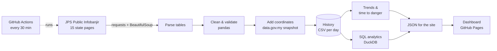

# Malaysia Flood Watch

A live dashboard of river water levels across Malaysia, powered by an automated data pipeline that collects, cleans and analyses readings from 560+ JPS telemetry stations every 30 minutes.

**[Open the live dashboard →](https://anthonyfiz.github.io/malaysia-flood-watch/)**

<!-- Screenshot: add docs/screenshot.png after the first runs -->

## Why I built this

During my internship at Pejabat Daerah dan Tanah Kuala Terengganu, I managed flood-victim data by hand in Excel and Google Sheets. Malaysia's river sensors publish their readings online, but the official portal only shows the **latest** value, one state at a time, with no history, no trends and no way to compare states. This project turns that feed into something you can actually analyse.

## What it does

- **Live map** of every station, coloured by its JPS status: Normal, Waspada (alert), Amaran (warning), Bahaya (danger)
- **Needs-attention and rising lists**, sorted by severity and how fast the water is rising
- **Station detail** with a 48-hour chart against the station's own alert, warning and danger levels
- **Trend and time-to-danger estimate**: a straight line fitted to the last 3 hours of readings
- **SQL analytics** (DuckDB): status per state, stations closest to danger, biggest 24-hour rises, stations most often at alert level, and national status over time
- **Data-quality reporting**: offline sensors, stale states and unreliable thresholds are flagged and shown, never silently dropped

## How it works



1. **Collect:** a GitHub Actions workflow runs every 30 minutes and fetches all 15 state pages from JPS, politely and one at a time.
2. **Clean:** numbers are parsed, sensor errors and bad timestamps are handled, duplicate IDs are kept apart, and each reading is classified using that station's own thresholds.
3. **Locate:** JPS pages have no coordinates, so stations are matched by name and ID to the data.gov.my flood-warning API. Unmatched stations are placed at their district centre and marked as approximate.
4. **Store:** new readings are appended to `data/history/YYYY-MM-DD.csv`. JPS keeps no history, so this repository *is* the dataset, and it grows with every run.
5. **Analyse:** DuckDB runs SQL over the history and the latest snapshot to produce the analytics.
6. **Publish:** the results are written as JSON to `docs/data/`, and GitHub Pages serves the dashboard.

No server, no database to host, no cost.

## What I found in the data

A snapshot of all 564 stations on the morning of 26 October 2026:

| Finding | Stations |
|---|---|
| Usable, up-to-date reading | 397 (70%) |
| Not updated in over 6 hours | 136, including **all of Johor (54) and Terengganu (34)**, plus 31 in Kelantan |
| Sensor offline (reports `-9,999`) | 26 |
| Placeholder or out-of-order thresholds (e.g. danger level 320 m on a river at 10 m) | 11 |
| Station IDs used for two different stations | 5 |
| Readings dated in the future | 2 |

Data cleaning rules, each covered by a test:

| Problem in the feed | How it's handled |
|---|---|
| `-9,999.00` (bad data) or `-8,888.00` (infilled estimate) | Marked **offline**, no status |
| Thousands separators (`1,273.71`) | Parsed correctly |
| Danger level >100 m above the reading, or alert > warning > danger out of order | Thresholds marked unreliable, no status |
| Normal level above the alert level | Status still works, but "how close to danger" isn't calculated |
| Reading older than 6 hours | Marked **stale**, excluded from live counts |
| Timestamp in the future | Marked invalid, not stored in history |
| Same ID for two stations | Second one becomes `ID-2` |

## Tech stack

**Python** (pandas, requests, BeautifulSoup) · **SQL** (DuckDB) · **GitHub Actions** · **JavaScript** (Leaflet, Chart.js) · **HTML/CSS** · **pytest**

## Run it yourself

```bash
pip install -r requirements-dev.txt
python -m pytest -q                  # tests run on a sample of real JPS rows
python -m floodwatch.run             # live run: fetches JPS and writes docs/data/
python -m http.server -d docs 8000   # then open http://localhost:8000
```

Offline run from the saved sample, with no internet needed:

```bash
python -m floodwatch.run --from-csv tests/fixtures/jps_rows_sample.csv --now 2026-10-26T09:10:00+08:00
```

## Project structure

```
floodwatch/
  scrape.py      fetch and parse JPS state pages
  clean.py       typing, validation, status and data-quality rules
  locate.py      coordinates (exact, or district centre)
  history.py     store readings, rate of change, time to danger, run log
  analytics.py   DuckDB SQL analytics
  run.py         runs the whole pipeline
data/
  reference/     station coordinates and district centres (from data.gov.my)
  history/       one CSV of readings per day (built by this project)
  runs.csv       summary of every pipeline run
docs/            the dashboard (GitHub Pages) and its JSON data
tests/           pytest suite with a real-data fixture
```

## Limitations and next steps

- "Time to danger" is a straight-line estimate, not a hydrological forecast.
- Rainfall isn't used yet. JPS publishes rainfall pages in the same format, so adding them is the natural next step.
- Once a few weeks of history have built up, the plan is to train a model (for example gradient boosting on recent level changes and rainfall) to predict the chance a station reaches alert level in the next 6 hours, and to compare it against the straight-line baseline.
- About 270 stations aren't in the coordinates snapshot, so their map position is approximate.

## Data source and disclaimer

Water-level data: **Jabatan Pengairan dan Saliran Malaysia (JPS)**, [Public Infobanjir](https://publicinfobanjir.water.gov.my/). Station coordinates: [data.gov.my](https://data.gov.my) flood-warning API.

This is an independent student project and **not an official flood warning service**. For official information, use JPS Public Infobanjir.

---

Built by **Muhammad Hafizuddin Zakaria**, Bachelor of Information Systems (Hons.) Intelligent Systems Engineering, UiTM · [LinkedIn](https://www.linkedin.com/in/muhammad-hafizuddin-zakaria-b81719304/)
